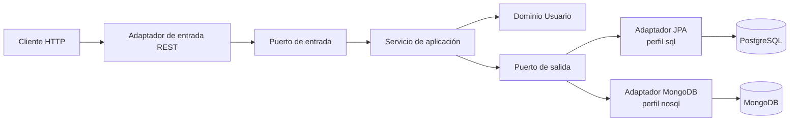

# Probando

API REST desarrollada con Spring Boot y organizada con arquitectura hexagonal (Ports and Adapters).

El proyecto está en desarrollo. Actualmente incluye persistencia SQL con PostgreSQL y una primera implementación NoSQL con MongoDB. La integración con MongoDB todavía está en pruebas y puede cambiar.

El código de este proyecto es propietario. Consulta [LICENSE](LICENSE) para conocer las condiciones de uso.

## Tecnologías

- Java 27
- Spring Boot 4.1.1
- Gradle
- Spring Web MVC
- Spring Data JPA e Hibernate
- PostgreSQL
- Spring Data MongoDB
- MongoDB
- Bean Validation
- Lombok
- OpenAPI/Swagger UI
- Docker Compose
- Testcontainers

## Arquitectura

El proyecto separa las reglas de negocio de los detalles externos mediante puertos y adaptadores:



### Capas

- `domain`: contiene el modelo `Usuario` y sus reglas de negocio, como la validación de edad, apellido y email.
- `application/port/in`: define los casos de uso disponibles para la aplicación, actualmente la creación de usuarios.
- `application/service`: implementa los casos de uso y coordina el dominio con los puertos de salida.
- `application/port/out`: define la interfaz que necesita la aplicación para persistir usuarios.
- `infra/adapter/in/web`: expone la API REST, sus DTOs, mapeadores, validaciones y el manejador global de errores.
- `infra/adapter/out/persistence/jpa`: implementa la persistencia mediante Spring Data JPA, entidades y mapeadores. Se activa con el perfil `sql`.
- `infra/adapter/out/persistence/nosql`: contiene el documento MongoDB, el repositorio Spring Data MongoDB, el mapeador y el adaptador NoSQL. Se activa con el perfil `nosql` y está en pruebas.
- `shared/config`: contiene configuración compartida, como OpenAPI.

La dependencia principal apunta hacia el centro: el dominio y la aplicación no dependen directamente de Spring Data ni de PostgreSQL. Los adaptadores implementan los puertos definidos por la aplicación.

## Estructura principal

```text
src/
├── main/
│   ├── java/alex/probando/
│   │   ├── shared/config/
│   │   └── usuarios/
│   │       ├── application/
│   │       │   ├── port/in/
│   │       │   ├── port/out/
│   │       │   └── service/
│   │       ├── domain/
│   │       └── infra/adapter/
│   │           ├── in/web/
│   │           └── out/persistence/
│   │               ├── jpa/
│   │               └── nosql/
│   └── resources/
├── test/java/
└── ...
```

## Requisitos

- JDK 27
- Docker y Docker Compose
- Gradle Wrapper incluido (`./gradlew`)

## Configuración y ejecución

La configuración actual activa el perfil `nosql` y usa MongoDB en `localhost:27017`. PostgreSQL también está definido para poder probar el perfil `sql`. Las credenciales y URLs están en `src/main/resources/application.properties`.

Para iniciar ambas bases de datos:

```bash
docker compose up -d
```

Después, inicia la aplicación con:

```bash
./gradlew bootRun
```

Para usar PostgreSQL mediante el adaptador JPA:

```bash
./gradlew bootRun --args='--spring.profiles.active=sql'
```

Para usar MongoDB mediante el adaptador NoSQL:

```bash
./gradlew bootRun --args='--spring.profiles.active=nosql'
```

En sistemas Windows:

```bat
gradlew.bat bootRun
```

La API estará disponible en `http://localhost:8080`.

## API

### Crear usuario

`POST /api/v1/usuarios`

Ejemplo de solicitud:

```json
{
  "nombre": "Juan Carlos",
  "apellido": "Bodoque",
  "email": "juan.bodoque@example.com",
  "edad": 30
}
```

Respuestas principales:

- `201 Created`: usuario creado correctamente.
- `400 Bad Request`: datos inválidos; la respuesta identifica el campo y el motivo.
- `409 Conflict`: ya existe un usuario con el mismo email.

Con el perfil `sql`, el email se almacena en la tabla `usuarios` de PostgreSQL. La persistencia MongoDB utiliza la colección `usuarios`; su comportamiento de índices y restricciones todavía forma parte de la implementación en pruebas.

## Documentación OpenAPI

Con la aplicación ejecutándose, Swagger UI está disponible en:

`http://localhost:8080/swagger-ui/index.html`

## Pruebas

Ejecuta la suite con:

```bash
./gradlew test
```

El proyecto incluye soporte para pruebas con Testcontainers y servicios PostgreSQL y MongoDB. El adaptador SQL y el adaptador NoSQL implementan el mismo puerto de salida, por lo que se selecciona uno mediante el perfil activo. MongoDB sigue siendo experimental.

## Licencia

Este proyecto es de uso propietario y no se distribuye bajo una licencia open source. Consulta [LICENSE](LICENSE) antes de copiar, modificar o redistribuir el código.
