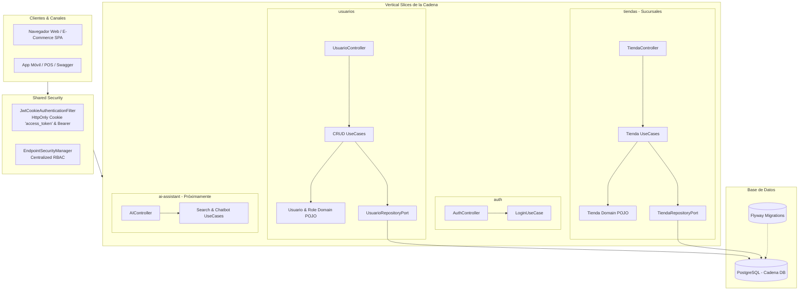

# 🥖 Store Chain Management & AI Assistant Backend

Backend robusto desarrollado con **Spring Boot**, estructurado bajo **Arquitectura Hexagonal (Ports and Adapters)** y **Vertical Slice Architecture**. 

Diseñado específicamente como el núcleo digital y operativo para **una sola marca / cadena de tiendas**, centralizando la gestión de sus sucursales, personal administrativo, catálogo de productos e inventario, con arquitectura preparada para incorporar un **Asistente Inteligente con Inteligencia Artificial (IA)**.

El código de este proyecto es propietario. Consulta [LICENSE](LICENSE) para conocer las condiciones de uso.

---

## 🎯 Enfoque y Modelo de Negocio

A diferencia de un marketplace abierto, esta plataforma está enfocada en el gobierno y operación de **una única empresa o cadena comercial**:
* **Gobierno Centralizado:** Las tiendas del sistema representan las **sucursales físicas y puntos de venta** oficiales de la marca (ej. *Sucursal Centro*, *Sucursal Escalón*, etc.).
* **Personal y Colaboradores:** Los usuarios administrativos (`ADMIN`, `RH`) son el personal interno de la empresa que gestiona sucursales, colaboradores y catálogo.
* **Clientes:** Usuarios compradores que pueden consultar el catálogo público, ubicar sucursales, registrarse e interactuar con la tienda. **Los clientes no crean tiendas ni administran sucursales.**

---

## 🤖 Visión Futura: Asistente Inteligente con IA

El backend cuenta con una arquitectura modular que permitirá integrar fácilmente el módulo **`ai-assistant`** como un copiloto omnicanal para la cadena:

### Para los Clientes de la Tienda:
* **Búsqueda Semántica de Productos:** Localización de productos en lenguaje natural (ej. *"¿tienen pan integral recién horneado bajo en sodio?"* o *"quiero un pastel para 15 personas"*).
* **Atención y Asesoría 24/7:** Chatbot que responde dudas sobre ingredientes, alérgenos, precios, horarios de atención y disponibilidad en cada sucursal.
* **Recomendaciones Inteligentes:** Sugerencias automáticas de productos complementarios según las preferencias del cliente.

### Para los Administradores de la Cadena:
* **Generación de Contenido para Catálogo:** Redacción automatizada de descripciones comerciales atractivas y optimizadas para SEO.
* **Analítica e Inteligencia de Inventario:** Consultas conversacionales para administradores (ej. *"¿cuál fue la sucursal con mayor venta de repostería esta semana?"* o alertas predictivas de stock).

---

## 🛠️ Stack Tecnológico

* **Lenguaje:** Java 27
* **Framework:** Spring Boot 4.1.1
* **Seguridad:** Spring Security 6+ con **JWT (JJWT)** y cookies **HttpOnly**
* **Control de Acceso:** RBAC centralizado (`ADMIN`, `RH`, `CLIENTE`)
* **Base de Datos:** PostgreSQL
* **Migraciones Versionadas:** **Flyway** (`V1__init_schema.sql`)
* **Persistencia:** Spring Data JPA / Hibernate (validación estricta de esquemas)
* **Build Tool:** Gradle
* **Documentación:** SpringDoc OpenAPI 3.0.2 / Swagger UI
* **Entornos de Prueba:** Docker Compose & Testcontainers
* **Herramientas:** Project Lombok

---

## 🏛️ Arquitectura: Hexagonal + Vertical Slices

El sistema se organiza por módulos funcionales cohesivos (**Vertical Slices**), manteniendo en cada uno la separación de responsabilidades que exige la **Arquitectura Hexagonal**:



### Reglas de Diseño:
1. **Dominio Desacoplado:** El modelo (`domain/`) no contiene anotaciones de base de datos ni librerías externas.
2. **Puertos y Adaptadores:** Toda comunicación externa se canaliza a través de puertos de entrada (`port/in`) y salida (`port/out`).
3. **Seguridad Centralizada:** Toda la política de seguridad se gobierna desde `EndpointSecurityManager`, dejando los controladores web limpios y enfocados.

---

## 📂 Organización del Proyecto

```text
src/main/java/alex/probando/
├── auth/                                    # Slice: Autenticación (Login, Logout, Sesión)
│   ├── application/ (LoginUseCase, AuthService)
│   └── infra/adapter/in/web/ (AuthController, DTOs)
│
├── usuarios/                                # Slice: Personal de la Cadena y Clientes
│   ├── domain/ (Usuario, Role)
│   ├── application/ (UseCases CRUD, UsuarioRepositoryPort, UsuarioService)
│   └── infra/adapter/ (UsuarioController, DTOs, Entidades JPA, Repositorios)
│
├── tiendas/                                 # Slice: Sucursales de la Cadena
│   ├── domain/ (Tienda)
│   ├── application/ (Create, GetById, ListActivas, Update, Delete)
│   └── infra/adapter/ (TiendaController, DTOs, TiendaEntity, Repositorios)
│
└── shared/                                  # Componentes Transversales
    ├── config/ (OpenApiConfig)
    ├── exception/ (GlobalExceptionHandler, Excepciones de Dominio)
    └── security/ (JwtService, JwtCookieAuthenticationFilter, EndpointSecurityManager, SecurityConfig)
```

---

## 🗄️ Migraciones de Base de Datos (Flyway)

Las migraciones SQL viven en `src/main/resources/db/migration/`:

* **`V1__init_schema.sql`**:
  * **Usuarios y Roles:** Tablas `roles`, `usuarios` y la relación `usuario_roles`.
  * **Sucursales y Catálogo:** Tablas `tiendas` (sucursales), `categorias` y `productos`.
  * **Índices de Alto Rendimiento:** Índices para optimizar búsquedas por email, username, precios y categorías.
  * **Semilla de Roles:** Carga inicial automática de roles (`ADMIN`, `RH`, `CLIENTE`).

---

## 🔐 Matriz de Permisos y Roles (RBAC)

* **`ADMIN` (Administradores de la Cadena):**
  * Control total: Crear, actualizar y eliminar sucursales (`POST/PUT/DELETE /api/v1/tiendas`).
  * Gestión de usuarios: Modificar roles, actualizar y eliminar cuentas (`/api/v1/usuarios/**`).
* **`RH` (Recursos Humanos):**
  * Consulta y gestión del listado de personal y usuarios de la cadena.
  * Consulta de sucursales de la empresa.
* **`CLIENTE` (Público General / Compradores):**
  * Consulta pública de las sucursales y sus ubicaciones.
  * Registro de cuenta y consulta de su propio perfil (`/api/v1/usuarios/perfil`).
  * **No tienen permisos para crear ni modificar sucursales de la cadena.**

---

## 🚦 Endpoints de la API

| Módulo | Método | Endpoint | Acceso Requerido | Descripción |
|---|---|---|---|---|
| **Auth** | `POST` | `/api/v1/auth/login` | Público | Inicia sesión y emite cookie HttpOnly `access_token` |
| **Auth** | `POST` | `/api/v1/auth/logout` | Público | Cierra sesión e invalida la cookie |
| **Auth** | `GET` | `/api/v1/auth/me` | Autenticado | Retorna datos y roles del usuario activo |
| **Usuarios** | `POST` | `/api/v1/usuarios` | Público | Registro de usuarios (rol inicial: `CLIENTE`) |
| **Usuarios** | `GET` | `/api/v1/usuarios` | `ADMIN` o `RH` | Listado general con filtro opcional (`?rol=ADMIN`, etc.) |
| **Usuarios** | `GET` | `/api/v1/usuarios/perfil`| Autenticado | Consulta del propio perfil |
| **Usuarios** | `GET` | `/api/v1/usuarios/{id}` | `ADMIN` o `RH` | Consulta de usuario por ID |
| **Usuarios** | `PUT` | `/api/v1/usuarios/{id}` | `ADMIN` | Actualización de usuario |
| **Usuarios** | `DELETE`| `/api/v1/usuarios/{id}`| `ADMIN` | Eliminación de usuario |
| **Usuarios** | `PATCH`| `/api/v1/usuarios/{id}/roles`| `ADMIN`| Asignación de roles al usuario |
| **Sucursales** | `GET` | `/api/v1/tiendas` | Público | Catálogo de sucursales activas de la cadena |
| **Sucursales** | `GET` | `/api/v1/tiendas/{id}` | Público | Información de una sucursal específica |
| **Sucursales** | `POST`| `/api/v1/tiendas` | **`ADMIN`** | Dar de alta una nueva sucursal de la cadena |
| **Sucursales** | `PUT` | `/api/v1/tiendas/{id}` | **`ADMIN`** | Modificar datos de una sucursal |
| **Sucursales** | `DELETE`| `/api/v1/tiendas/{id}`| **`ADMIN`** | Dar de baja una sucursal |

---

## 🚀 Puesta en Marcha

### 1. Iniciar Base de Datos con Docker Compose

```bash
docker compose up -d
```

### 2. Ejecutar la Aplicación

```bash
./gradlew bootRun
```

La aplicación se levantará en: `http://localhost:8080`.

### 3. Documentación Interactiva OpenAPI / Swagger UI

Abre en tu navegador:  
👉 **`http://localhost:8080/swagger-ui/index.html`**

### 4. Ejecución de Pruebas Automatizadas

```bash
./gradlew test
```

---

## 📄 Licencia

Este software es de carácter propietario. Consulta el archivo [LICENSE](LICENSE) para conocer los términos de uso.
